# PLAN: CANONICAL_ODDD_ARCHITECTURE_PLAN.MD

## SQUAD & SWARM
- **Architect:** Vidus (Lead Architect - Bounded Context & Living Organs Design)
- **Developer:** An (Core Engine & Supabase/MCP Protocol Implementation)
- **UX/UI:** Luna & Iris (Minimalist DeepMind Monochrome Admin & Public UX)
- **Algorithms:** Zenith (Cadence 50/10 Telemetry & Flow State Benchmark)
- **Strategy:** `Consensus` - Đồng thuận kiến trúc phân tầng 7 Living Organs, loại bỏ hoàn toàn mock fallback.

## RESEARCH & REASONING
- **Status:** Completed
- **Notes:** Áp dụng mô hình Organism Domain-Driven Design (O-DDD) chuẩn hóa từ Aevum OS sang dự án I2FLabs Research Page nhằm bảo toàn tính module hóa, zero-trust boundary, và phục vụ tương tác đa tác tử AI qua MCP.

## DESCRIPTION
Bản kế hoạch thiết lập và nghiệm thu toàn diện mô hình kiến trúc O-DDD cho cổng nghiên cứu học thuật I2FLabs Research Page. Hệ thống phân rã toàn bộ nghiệp vụ và kỹ thuật thành 8 Bounded Domains ánh xạ vào 7 Living Organs sinh học, kết nối MCP Serverless Gateway trên Vercel, đồng bộ 100% dữ liệu thực từ Supabase và đóng băng toàn bộ mã nguồn lên nhánh `main`.

## GOAL
1. Thiết lập 8 Domains chuẩn và 18 Bounded Features trong cây thư mục `.aevum/domains/`.
2. Vượt qua 100% kiểm định tính toàn vẹn `aevum_boundary_guard` (Sanity Check: PASS, Boundary Audit: 0 vi phạm).
3. Đóng gói mã nguồn sạch, build thành công (`npm run build` không lỗi type), commit toàn bộ thay đổi lên Git `main`.

## ARCHITECTURAL CONTEXT

```mermaid
graph TD
    subgraph Circulatory_Kernel ["Circulatory Kernel (Nền tảng Hạt nhân)"]
        CP["core_platform"]
        CP --> SC["Supabase Client & Buckets"]
        CP --> TS["Type System Contracts"]
        CP --> ST["Styles & Monochrome Tokens"]
    end

    subgraph Cognitive_Reflex ["Cognitive Reflex (Vỏ não Tri thức)"]
        RKE["research_knowledge_engine"]
        RKE --> MD["Markdown + KaTeX + Mermaid Engine"]
        RKE --> RC["Report Catalog & Cmdk Discovery"]
    end

    subgraph Agent_Mesh ["Agent Swarm Mesh (Mạng lưới Tác tử)"]
        MCP["mcp_aevum_gateway"]
        MCP --> VS["Vercel Serverless /rpc & /sse"]
        MCP --> AB["Aevum OS Local Bridge"]
        MCP --> MA["Master Auth Key Guard"]
    end

    subgraph Metabolic_Cloud ["Metabolic Cloud & IAM (Danh tính & Phân quyền)"]
        AUTH["auth_and_access_control"]
        AUTH --> SI["Session & Identity"]
        AUTH --> MDG["Member Domain Governance"]
    end

    subgraph Presentation_Sensory ["Presentation Sensory (Giác quan Trình diễn)"]
        PUB["public_research_portal"]
        ADM["admin_research_studio"]
        PUB --> HRE["Home & Reading Experience"]
        PUB --> SDE["Strategic 5-Domain Explorer"]
        ADM --> AWS["DeepMind Monochrome Shell"]
        ADM --> DMC["Domain Management Console"]
    end

    subgraph Immune_Security ["Immune Security (Miễn dịch Ranh giới)"]
        COMP["compliance_and_data_integrity"]
        COMP --> NFG["No-FOMO Database Guard"]
        COMP --> MLS["Media Sanitization"]
    end

    subgraph Neuro_Lab ["Neuro-Cognitive Lab (Nhịp độ & Chất lượng)"]
        FCT["flow_cadence_telemetry"]
        FCT --> CB["Cadence 50/10 Benchmarks"]
        FCT --> VB["Vite Production Build Verify"]
    end

    CP --> RKE
    CP --> MCP
    CP --> AUTH
    RKE --> PUB
    AUTH --> ADM
    NFG -. Bảo vệ dữ liệu thật .-> CP
    MCP -. Đo lường Telemetry .-> FCT
```

*Hình 1: Sơ đồ kiến trúc 7 Living Organs ánh xạ 8 Bounded Domains của I2FLabs Research Page*

## BOUNDARY & ENCAPSULATION
- **Public API (Exports):**
  - `@/types`: Các contract chuẩn hóa (`database/`, `reports/`, `domains/`, `admin/`, `auth/`).
  - `@/lib/supabase`: Khởi tạo PostgREST & Auth singleton.
  - `@/features/*`: Các module nghiệp vụ tự đóng gói, chỉ export qua index hoặc API file.
- **Hidden Internals:**
  - Logic xác thực token nội bộ của MCP Server tại `intergrations/mcp/src/auth.ts`.
  - Cơ chế cache và local proxy trong `intergrations/mcp/src/httpServer.ts`.
- **Optimization Targets:**
  - Build time: < 90s (Vite production bundle chunking).
  - MCP Telemetry Latency: P50 < 300ms.
  - Boundary Violations: 0 (ADAM Boundary Rule compliant).

## IMPLEMENTATION STEPS

### Phase 1: Phân Rã Bounded Context & Định Vị 7 Living Organs
- [x] [ARCH] Khởi tạo 8 Bounded Domains trong `.aevum/domains/` [Evidence: aevum_architecture_inspect]
- [x] [ARCH] Khởi tạo 18 Bounded Features tương ứng trong từng domain [Evidence: index.json updated]
- [x] [DOC] Biên tập 8 tài liệu `context.md` đặc tả phạm vi và quyền hạn từng domain [Evidence: 8 context.md files]

### Phase 2: Chuẩn Hóa Ranh Giới Mã Nguồn & Triệt Tiêu Dữ Liệu Ảo
- [x] [CODE] Tách biệt Types hệ thống theo 5 phân vùng chuyên biệt [Evidence: src/types/*]
- [x] [CODE] Cải tổ giao diện Admin theo phong cách DeepMind Monochrome tối giản [Evidence: AdminLayout.tsx]
- [x] [CODE] Tích hợp phân quyền chọn và quản trị Miền nghiên cứu theo tài khoản [Evidence: DomainSelector.tsx]
- [x] [CODE] Xây dựng MCP Serverless Gateway trên Vercel với Authentication Key [Evidence: intergrations/mcp]
- [x] [CODE] Loại bỏ hoàn toàn Mock/Fallback catalogs, chuyển sang 100% Supabase Live [Evidence: researchCms.ts]

### Phase 3: Kiểm Định Toàn Vẹn & Bàn Giao Nhánh Main
- [x] [TEST] Chạy kiểm định tính toàn vẹn cấu trúc `sanity_check` [Evidence: 100% compliant, 0 KO]
- [x] [TEST] Chạy kiểm định ranh giới `audit_boundary` [Evidence: 0 violations across 7 modules]
- [x] [CMD] Chạy bản build sản phẩm `npm run build` [Evidence: vite build exit code 0]
- [x] [GIT] Commit toàn bộ hệ thống lên nhánh `main` [Evidence: git log]
